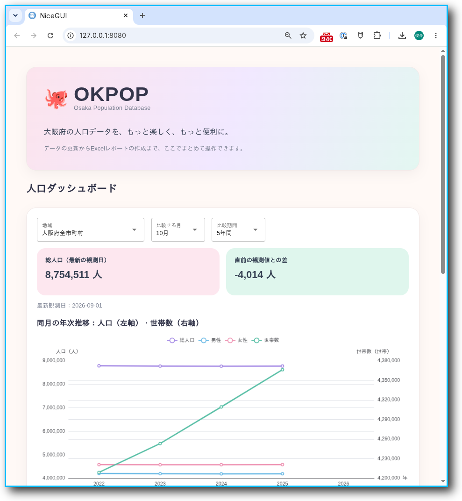
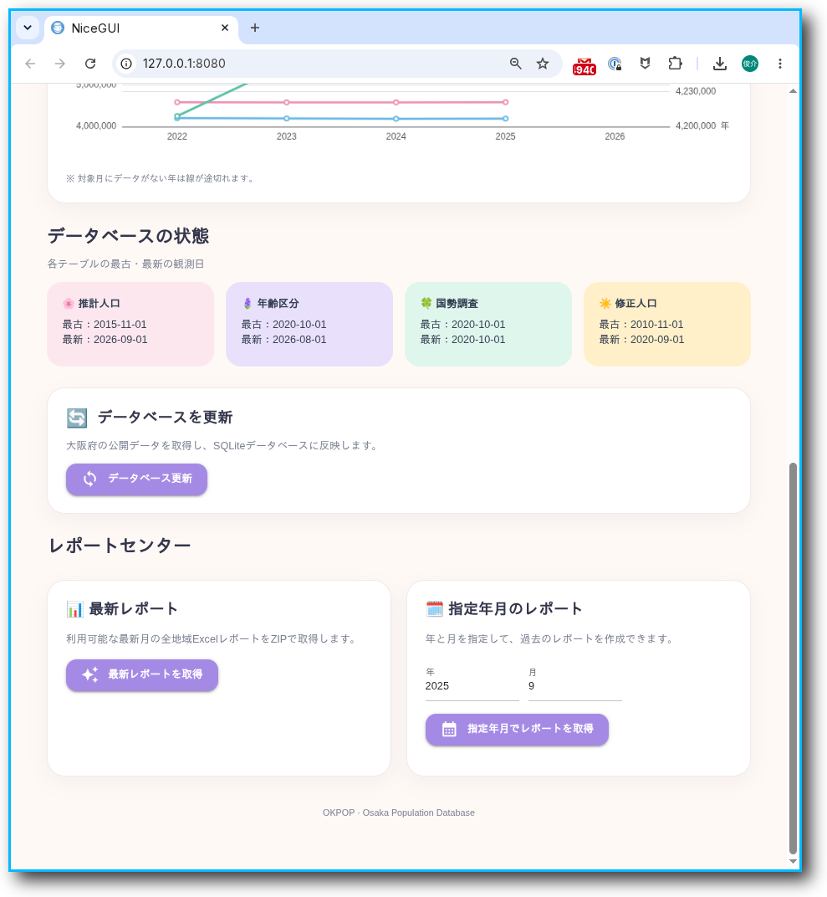

<div align="center">


<br>

**Collect. Process. Store. Report.**

`Python` · `pandas` · `SQLite` · `NiceGUI` · `openpyxl` · `uv`

</div>


## 🏯 About OKPOP

**OKPOP** is a toolkit for collecting, processing, storing, and
reporting population data published by Osaka Prefecture.

大阪府が公表する人口統計データを取得・整形し、
SQLiteデータベースとして蓄積・管理し、
Excelレポートとして出力するためのPythonプロジェクトです。

OKPOP currently handles:

- **Census** — 国勢調査
- **Estimated Population** — 推計人口
- **Revised Population** — 修正人口
- **Population by 5-Year Age Group** — 年齢5歳階級別人口

公開されているExcelファイルの取得から、
データベースへの取り込み、レポート作成までを
一連の処理として扱うことを目的としています。


## ✨ Features

- 大阪府Webサイトから人口統計Excelを取得
- ファイル名・対象年月・データ種別を判定
- Excelデータをpandasで読み込み・整形
- SQLiteデータベースへ保存
- SQL Viewによるレポート用データの統合
- 全地域のExcel人口レポートを自動生成
- レポートをZIPアーカイブとして出力
- 最新年月・指定年月のレポート作成
- 作成済みレポートZIPの再利用
- GmailによるレポートZIPの送信
- NiceGUIによる人口推移ダッシュボード・データベース更新・レポート操作
- pytestによるデータ処理・DB・レポート処理のテスト


## 🚀 Quick Start — Windows

OKPOPは、Windows上で動作するGUI付きの人口統計データ管理ツールです。

**PythonやGitを事前にインストールする必要はありません。**

初回のみ、以下の手順でセットアップしてください。

### Step 1 — Download OKPOP


[OKPOPのGitHubページ](https://github.com/syunsuke/okpop)を開き、緑色の **Code** ボタンをクリックします。

<div align="center">
  
  <p><sub>▲ 赤丸で囲んだ「Code」をクリック</sub></p>
</div>

表示されたメニューから **Download ZIP** を選択し、ダウンロードしたZIPファイルを展開してください。


展開した `okpop-main` フォルダがOKPOPの作業フォルダになります。

### Step 2 — Install uv

OKPOPは、Pythonの実行環境を管理する **uv** を使用します。

Windowsのスタートメニューから「ターミナル」または「PowerShell」を起動し、次のコマンドを実行してください。

```powershell
winget install --id=astral-sh.uv -e
```

インストール後、ターミナルを一度閉じて開き直します。

```powershell
uv --version
```

バージョン番号が表示されればインストール成功です。

> **What is uv?**
>
> uvはPythonの環境構築とパッケージ管理を自動化するツールです。OKPOPでは、Python本体や必要なライブラリの準備に使用します。

### Step 3 — Setup OKPOP

エクスプローラーで展開した `okpop-main` フォルダを開きます。

アドレスバーに `powershell` と入力し、Enterキーを押してください。

開いたPowerShellで、次のコマンドを実行します。

```powershell
uv run okpop setup
```

初回セットアップでは、次の処理が自動的に行われます。

- Python実行環境の準備
- 必要なライブラリのインストール
- 大阪府の人口統計Excelデータのダウンロード
- SQLiteデータベースの構築

`Setup completed.` と表示されれば完了です。

> **Note**
>
> 初回はデータのダウンロードとデータベース構築に時間がかかる場合があります。インターネット接続が必要です。

### Step 4 — Launch OKPOP

同じPowerShellで、次のコマンドを実行します。

```powershell
uv run python -m okpop.app.main
```

表示されたローカルURLをブラウザで開くと、OKPOPのGUIを利用できます。

### Next Time

2回目以降は、`okpop-main` フォルダでPowerShellを開き、GUI起動コマンドを実行するだけです。

```powershell
uv run python -m okpop.app.main
```

---

**Ready to explore Osaka's population data? 🐙**


## ⚡ Workflow

```text
            Osaka Prefecture
                   │
                   ▼
            Excel files
                   │
                   ▼
          Fetch / File Check
                   │
                   ▼
              Importer
                   │
                   ▼
          ┌─────────────────┐
          │     SQLite      │
          │ Population DB   │
          └────────┬────────┘
                   │
                   ▼
              SQL Views
                   │
                   ▼
           Excel Reports
                   │
                   ▼
             ZIP Archive
              │       │
              ▼       ▼
           NiceGUI   Gmail
```


## 🖥 Dashboard & GUI

OKPOP includes a browser-based dashboard built with **NiceGUI** for exploring
Osaka Prefecture population statistics and managing the local SQLite database.

### 📈 Population Dashboard

Explore historical population trends using interactive graphs.

- Select a region and reference month.
- Compare data for the same month across multiple years (5 or 10 years, where available).
- Visualize total population, male population, female population, and households.

<div align="center">



</div>

### 🗃 Database Management & Reports

Manage the datasets and generate reports directly from the GUI.

- Check the earliest and latest observation dates stored for each dataset.
- Update the population database.
- Retrieve the latest available report or generate one for a specified year and month.
- Download generated ZIP archives.

<div align="center">



</div>

### Launch the GUI

From the project root, run:

```bash
uv run python -m okpop.app.main
```

Open the local URL displayed in the terminal in your browser.


## 🗂 Project Structure

```text
okpop/
├── assets/
│   ├── okpop-banner.png
│   ├── dashboard-population.png
│   ├── dashboard-database.png
│   └── templates/
│       └── populaiton_report_template_0001.xlsx
│
├── src/
│   └── okpop/
│       ├── __init__.py
│       ├── database.py
│       ├── area.py
│       ├── census.py
│       ├── suikei.py
│       ├── hosei.py
│       ├── kubun.py
│       ├── utildate.py
│       ├── dl.py
│       ├── filecheck.py
│       ├── source.py
│       ├── fetch.py
│       ├── importer.py
│       ├── report.py
│       ├── mail.py
│       └── app/
│           ├── __init__.py
│           ├── actions.py
│           └── main.py
│
├── sql/
│   ├── schema.sql
│   └── views.sql
│
├── data/
│   ├── raw/
│   ├── db/
│   │   └── population_osaka.sqlite
│   └── output/
│
├── sandbox/
│   └── scripts/
│
├── tests/
│
├── pyproject.toml
├── uv.lock
└── README.md
```

## 🔗 Data Sources

OKPOP uses population statistics published by the
**Osaka Prefectural Government (大阪府)** as its primary data source.

### Osaka Prefecture Population Statistics

- [大阪府の毎月推計人口](https://www.pref.osaka.lg.jp/o040090/toukei/jinkou/index.html)
- [推計人口（月報）](https://www.pref.osaka.lg.jp/o040090/toukei/jinkou/jinkou-xlslist.html)
- [過去の推計人口（補正値）](https://www.pref.osaka.lg.jp/o040090/toukei/jinkou/jinkou-h.html)
- [過去の推計人口（補正前）](https://www.pref.osaka.lg.jp/o040090/toukei/jinkou/jinkou-h2.html)
- [国勢調査](https://www.pref.osaka.lg.jp/o040090/toukei/chousa/kokucho.html)

The original statistical data is published by Osaka Prefecture.
OKPOP downloads and processes these source files to build its SQLite
database and generate reports.

> **Note**
>
> OKPOP is an independent project and is not affiliated with or endorsed by
> the Osaka Prefectural Government.

## 🗃 Population Database

The OKPOP database integrates several types of population statistics.

| Data | Table | Description |
|---|---|---|
| 国勢調査 | `census` | Population measured by the national census |
| 推計人口 | `suikei` | Monthly estimated population |
| 補正人口 | `hosei` | Revised population estimates |
| 5歳階級人口 | `population_age5_v001` | Population by 5-year age group (85+) |
| 5歳階級人口 | `population_age5_v002` | Population by 5-year age group (95+) |

The database is stored as SQLite and uses SQL views to combine
the different data sources for reporting.


## 📊 Reports

OKPOP generates Excel population reports from the SQLite database.

```text
SQLite
   │
   ▼
view_excel_report_data
   │
   ▼
Python
   │
   ▼
Excel template
   │
   ▼
Population report
```

Reports are generated for all supported areas and collected into
a ZIP archive.

Archive names are based on the report reference month:

```text
okpop_report_202608.zip
```

If the archive for the same reference month already exists,
OKPOP reuses it instead of generating all reports again.


## 🐍 Development

OKPOP uses **uv** for Python project and dependency management.

Clone the repository:

```bash
git clone git@github.com:syunsuke/okpop.git
cd okpop
```

Create or synchronize the environment:

```bash
uv sync
```

Run the test suite:

```bash
uv run pytest
```

Run the GUI:

```bash
uv run python -m okpop.app.main
```


## 🔧 Workflow Scripts

Development and maintenance workflows are available under
`sandbox/scripts/`.

```text
workflow_build.py
    Build the database from scratch.

workflow_update.py
    Download new source data and update the existing database.

workflow_report.py
    Generate the population report archive.

workflow_report_mail.py
    Generate the report archive and send it by Gmail.
```


## 🧰 Tech Stack

| | Technology | Role |
|---|---|---|
| 🐍 | Python | Application and data processing |
| 🐼 | pandas | Data transformation |
| 🗄️ | SQLite | Population database |
| 📗 | openpyxl | Excel report generation |
| 🌐 | requests / Beautiful Soup | Data acquisition |
| 🖥️ | NiceGUI | Web user interface |
| 🧪 | pytest | Testing |
| ⚡ | uv | Project and dependency management |


## 🐙 Why "OKPOP"?

**OKPOP** is a recursive acronym:

> **OKPOP Knows Population of Osaka Prefecture**

which expands forever:

```text
OKPOP
└── OKPOP Knows Population of Osaka Prefecture
    └── OKPOP Knows Population of Osaka Prefecture
        └── OKPOP Knows Population of Osaka Prefecture
            └── ...
```

**Because OKPOP knows Osaka's population. 🐙**


---

<div align="center">

**OKPOP**

*Population data for Osaka Prefecture.*

🐙

</div>
